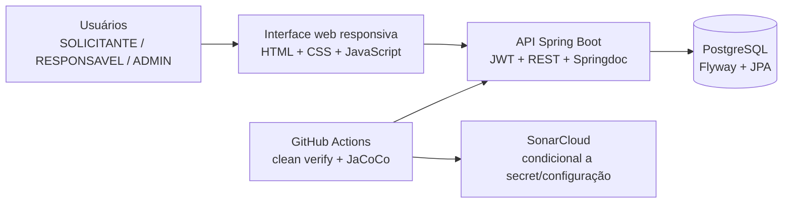
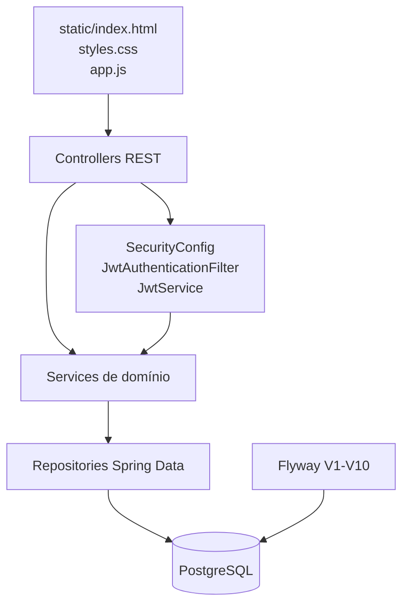
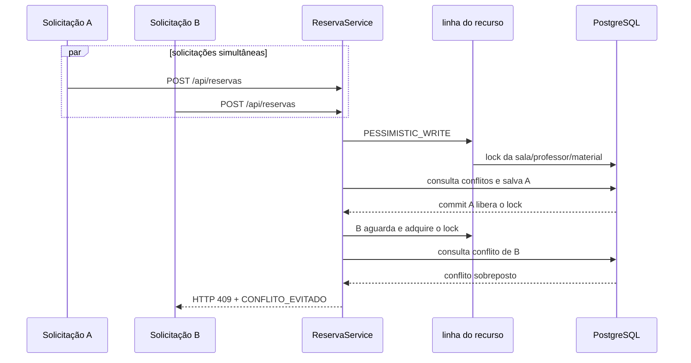

# Diagramas da solução

Os diagramas abaixo são Mermaid versionável e representam o código atualmente entregue.

## Contexto

## Componentes

## Sequência: reserva concorrente

A implementação concreta está em `ReservaService`, nos métodos de criação/atualização, e nos repositórios com `@Lock(PESSIMISTIC_WRITE)`. A evidência concorrente está em `ReservaConcorrenciaPostgresTest` e `ManutencaoReservaConcorrenciaPostgresTest`.
